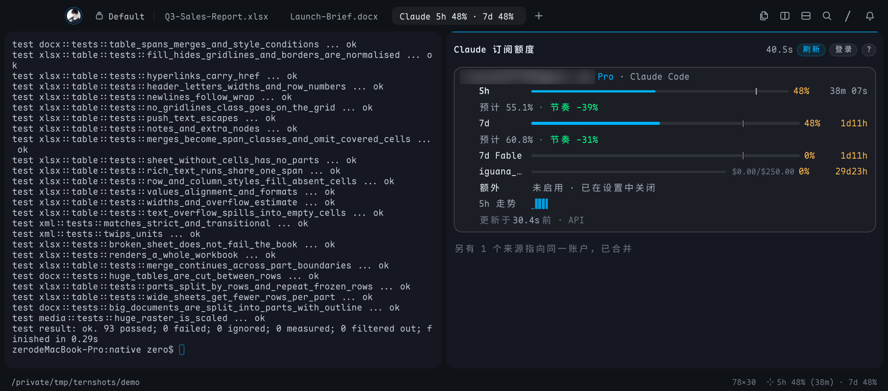

# Claude Usage（Tern 插件）

在 Tern 里实时查看 Claude Pro / Max 与 ChatGPT（Codex）订阅额度，支持两家各自的**多个账户**：5 小时窗口、7 天窗口、分模型周额度（Opus / Sonnet / Fable …）、额外用量（usage credits）、促销类额度、ChatGPT 代码审查额度与 credits 余额；有两个以上账户时给出跨账户汇总（平均用量、剩余份额、可用账户数、最空闲账户、最早恢复）。两家都能在面板里直接 OAuth 登录，每家可登录多个账户。面板顶部的 Claude / GPT 标签决定面板和状态栏默认显示哪一家。



## 安装

```sh
tern plugin link /path/to/tern-plugins     # 开发时链接；或 tern plugin install <dir|git url>
```

需要在 Preferences › Plugins 里打开插件（`settings.json` 的 `"plugins": true`，且 `plugins_disabled` 不含 `claude-usage`）。

- 命令面板：**订阅用量（Claude / GPT）：显示 / 隐藏额度浮窗** / **Claude 用量：登录订阅账户（可添加多个）** / **GPT 用量：登录 ChatGPT 账户（可添加多个）**，或 **New Claude Usage block**（普通分屏块）。
- 状态栏（需打开 Tern 状态栏）：默认显示当前标签那一家的固定账户（没有固定时为第一个），Claude 为 `5h 42% (2h13m) · 7d 18% +2`，GPT 为 `GPT 5h 12% (48m) · 7d 30%`（只有 7 天窗口的套餐显示 `GPT 7d 9% (5d20h)`），`+N` 是其余账户数；颜色随用量变化，点击切换浮窗。显示方式可在设置里改，见下文。

浮窗固定在当前标签页右上角（`cx.layout:float(..., "tr")`）。再次执行"显示 / 隐藏"关闭它；当前标签页已有平铺的额度块时改为把它浮起并聚焦，不重复打开。两个登录命令会替换已有浮窗，以带登录参数重新打开。

## 面板

顶部 **Claude / GPT** 标签切换显示哪一家（`Tab` 或 `1` / `2`，也可点击）。选择会保存，下次打开面板和状态栏都默认显示这一家；所有打开的面板一起切换。两家的账户始终都在轮询（隐藏的除外），切换不需要重新请求。

### 汇总

当前标签有两个以上带数据的账户时，顶部显示汇总卡（隐藏的账户不计入）：

| 内容 | 说明 |
| --- | --- |
| 5h / 7d 平均 | 各账户用量的平均值；进度条上的刻度是各账户自己的用量（悬停可看最低 / 最高） |
| 余 N 份 | 各账户未用额度之和，折合多少个完整窗口（例如 3 个账户分别用了 90% / 10% / 100%，余 1.0 份） |
| 可用 a/b | 5h、7d 都未用尽的账户数 / 有数据的账户数 |
| 最空闲 | 5h、7d 中较高者最低、且没有报错的账户；点击选中它 |
| 最早恢复 | 已用尽的账户里最先恢复的那个及剩余时间（需要等它所有用尽的窗口都重置） |

### 布局

| 布局 | 说明 |
| --- | --- |
| 自动（默认） | 两个账户以内用卡片，三个及以上用紧凑 |
| 卡片 | 每个账户一张卡片；面板宽于 120 列且有多个账户时卡片并排 |
| 紧凑 | 每个账户一行（名称 · 套餐 · 5h / 7d 进度条与百分比 · 重置倒计时），下方是选中账户的完整卡片 |

卡片内容：

| 内容 | 说明 |
| --- | --- |
| 窗口进度条 | 服务端返回的利用率；竖线标出窗口已过去的时间比例 |
| 节奏 | 与均匀使用相比超出/低于多少；按当前平均速度会在重置前用尽时给出预计用尽时间 |
| 重置 | 一天内为实时倒计时，之外为剩余时长；后面是本地时间 |
| 额外用量 | Claude：本月已用 / 上限，或未启用及原因；GPT：有 credits 或无限时显示余额 |
| 走势 | 最近 48 次采样的 5h / 7d 迷你折线 |
| 更新于 | 数据年龄与来源（API / Claude Code 缓存 / 上次缓存） |
| 账户操作 | 仅选中的卡片：重命名 · 固定到状态栏 · 隐藏 · ↑ ↓ · 移除（仅插件登录） |

文字不换行，放不下时以 … 截断。窄于 60 列时隐藏来源、节奏细节和走势（只保留"预计用尽"警告）；90 列以上再显示重置的本地时间和 7d 走势。完整说明在悬停提示里，按键列表在 `?` 里。

### 账户自定义

偏好按账户本身（提供方 + 用户 + 组织）保存在 kv `prefs`，同一账户从哪个来源读到都适用，来源换了登录也不会张冠李戴。

| 操作 | 按键 | 说明 |
| --- | --- | --- |
| 重命名 | `e` | 设置别名，显示在卡片、紧凑行、汇总和状态栏；留空恢复为邮箱 |
| 固定到状态栏 | `p` | 状态栏「固定/首个」模式显示此账户；每家只能固定一个 |
| 隐藏 | `h` | 不显示、不刷新、不进状态栏和汇总；`a` 列出已隐藏账户，选中后再按 `h` 恢复 |
| 移动 | `J` / `K` | 下移 / 上移，并切换为手动排序（从当前看到的顺序开始） |
| 移除 | `x` | 仅插件登录的账户，回车确认 |

### 设置

`,` 或 ⚙ 打开设置面板（两个标签共用，自动保存在 kv `settings`）：

| 分组 | 选项 |
| --- | --- |
| 布局 | 自动 / 卡片 / 紧凑（`v` 循环切换） |
| 排序 | 手动 / 用量（最忙的在前）/ 重置时间（最先重置的在前）/ 名称 |
| 显示 | 节奏 · 走势 · 分模型/其他额度（关闭后卡片只留 5h / 7d、额外用量与余额）· 已隐藏账户 |
| 状态栏 | 显示（`s`）· 固定/首个 · 最空闲（带账户名，`b 5h 10% (1h) · 7d 20% +2`）· 全部（每个账户一段 `名称 5h%/7d%`，每家最多 4 段）· 当前标签 / 两家 |
| 来源 | Claude Code（`c`，Claude 标签）· Codex CLI（`c`，GPT 标签）· omp（`o`） |
| 刷新 | 30s / 1m / 2m / 5m / 10m（`+` / `-`） |

按键：`Tab` / `1` / `2` 切换 Claude / GPT · `r` 立即刷新 · `l` 登录当前标签的账户 · `j`/`k` 选择账户 · `J`/`K` 移动 · `e` 重命名 · `p` 固定 · `h` 隐藏 · `a` 列出已隐藏 · `v` 布局 · `x` 移除 · `+`/`-` 刷新间隔 · `c` / `o` 来源 · `s` 状态栏 · `,` 设置 · `?` 按键说明 · `Esc` 关闭面板 / 取消登录 / 取消重命名。

## 账户来源

| 来源 | 位置 | 令牌刷新 |
| --- | --- | --- |
| 插件登录（Claude / ChatGPT，可多个） | `<state>/plugin-data/claude-usage/accounts.json`（权限 600；行内 `provider` 区分，没有该字段的旧行视为 Claude） | 过期前自动刷新（Claude 走 `platform.claude.com`，ChatGPT 走 `auth.openai.com`），轮换后的 refresh token 写回同一文件 |
| Claude Code | macOS 钥匙串 `Claude Code-credentials`（设置了 `CLAUDE_CONFIG_DIR` 时带哈希后缀），否则 `~/.claude/.credentials.json` | 先重读存储（Claude Code 可能已自行刷新）；仍过期才刷新，并把新令牌对写回原处、保留其他字段，Claude Code 继续可用 |
| Codex CLI（GPT） | `$CODEX_HOME/auth.json`（默认 `~/.codex/auth.json`，即 `codex login` 的 ChatGPT 登录；钥匙串存储模式不支持） | 过期时间取自 access token（JWT `exp`）；先重读文件，仍过期才向 `auth.openai.com` 刷新，把新的 access / refresh / id token 与 `last_refresh` 写回、保留其他字段并保持权限 600，Codex 继续可用 |
| omp | `~/.omp/agent/agent.db`（`sqlite3 -readonly`，`anthropic` 与 `openai-codex` 两类 OAuth 行） | 只读，不刷新（刷新会使 omp 的登录失效）；过期时提示在 omp 中重新登录，或在插件里用 `l` 登录 |

同一账户出现在多个来源时只显示、只请求一次：Claude 按 account uuid + org uuid，GPT 按 ChatGPT user id + account id。优先级：插件登录 > Claude Code / Codex > omp。

## 登录

`l` 或「+ 账户」登录当前标签那一家的账户；重复登录可添加多个，同一账户再次登录只更新令牌。生成 PKCE（`od` 读 `/dev/urandom`）后在系统浏览器打开授权页。

**Claude**：`https://claude.ai/oauth/authorize`。

- 本机 54545 端口空闲时，用 `nc -l 54545` 接住回调 `http://localhost:54545/callback`，授权后自动完成。
- 端口被占用时改用 `https://platform.claude.com/oauth/code/callback`，页面显示 `code#state`，粘贴到面板（⌘V）即可；回调 URL 也可直接粘贴。
- 令牌端点依次尝试 `platform.claude.com` 与 `api.anthropic.com`。

**ChatGPT**：`https://auth.openai.com/oauth/authorize`（Codex CLI 的公开 client，带 `prompt=login`，便于在浏览器已登录其他账户时选择另一个账户）。

- 回调只能是 `http://localhost:1455/auth/callback`。1455 端口空闲时用 `nc -l 1455` 接住，授权后自动完成。
- 端口被占用（例如 Codex 正在登录）时浏览器会停在打不开的 localhost 页面，把地址栏 URL 粘贴到面板即可。
- 授权码以表单方式在 `auth.openai.com/oauth/token` 换取 access / refresh / id token；邮箱、套餐、用户与账户 id 取自 JWT。

## 刷新策略

- Claude 数据源：`GET https://api.anthropic.com/api/oauth/usage`（`anthropic-beta: oauth-2025-04-20`），账户信息来自 `/api/oauth/profile`（每次会话每账户一次）。
- GPT 数据源：`GET https://chatgpt.com/backend-api/wham/usage`（`ChatGPT-Account-Id` 头），邮箱、套餐和账户 id 都在响应里。`primary_window` / `secondary_window` 按 `limit_window_seconds` 命名为 5h / 7d（部分套餐只有 7 天窗口），另有 `code_review_rate_limit`（显示为 `7d Review`）和 `additional_rate_limits`。
- 面板打开时按间隔轮询（默认 60s）；关闭后按后台间隔（300s）轮询供状态栏使用；状态栏关闭且面板未打开时不发请求。账户依次请求，隐藏的账户跳过。
- Claude Code 运行时会把它最新的用量写进 `~/.claude.json`，若比插件的数据新且属于同一账户，直接采用，不额外请求。
- 429 时遵循 `Retry-After`，否则从 1 分钟起指数退避（上限 15 分钟），期间保留上次数据；`r` 可强制刷新。401 时自动刷新令牌重试一次。

## 开发

```sh
brew install luau
python3 tests/run.py          # 纯模块 + 主机/窗口流程（假的 tern 运行时）
```

`tests/run.py` 把模块打包成单个 chunk 运行（独立 `luau` 会隔离每个模块的全局变量，无法注入假的 `tern`）。

| 文件 | 作用 |
| --- | --- |
| `host.luau` | 块 `claude-usage.usage`：按键、事件、标签切换、登录、账户操作 |
| `window.luau` | 状态栏段（固定/首个、最空闲、全部；当前标签或两家）与命令面板命令 |
| `lib/poller.luau` | 共享轮询：多来源合并、令牌刷新、退避、缓存、账户偏好（kv `prefs`）与排序、设置（kv `settings`）、状态摘要（kv `status`） |
| `lib/stats.luau` | 跨账户汇总（平均、剩余份额、可用数、最空闲、最早恢复）与状态栏账户挑选 |
| `lib/usage.luau` | Claude `/usage` 与 ChatGPT `wham/usage` 响应归一化与节奏计算 |
| `lib/oauth.luau` | Claude OAuth 常量、PKCE、换码、刷新、API 请求 |
| `lib/codex.luau` | ChatGPT：JWT 声明、授权页、换码、令牌刷新、`wham/usage` 请求 |
| `lib/creds.luau` | 四种凭据来源的读写 |
| `lib/login.luau` | 两家通用的登录流程（回环监听 + 粘贴） |
| `lib/view.luau` | 面板视图：汇总、卡片 / 紧凑布局、设置、重命名、登录 |
| `lib/crypto.luau` / `lib/time.luau` | SHA-256、base64url 编解码、URL 编码；ISO 时间与时长文本 |
